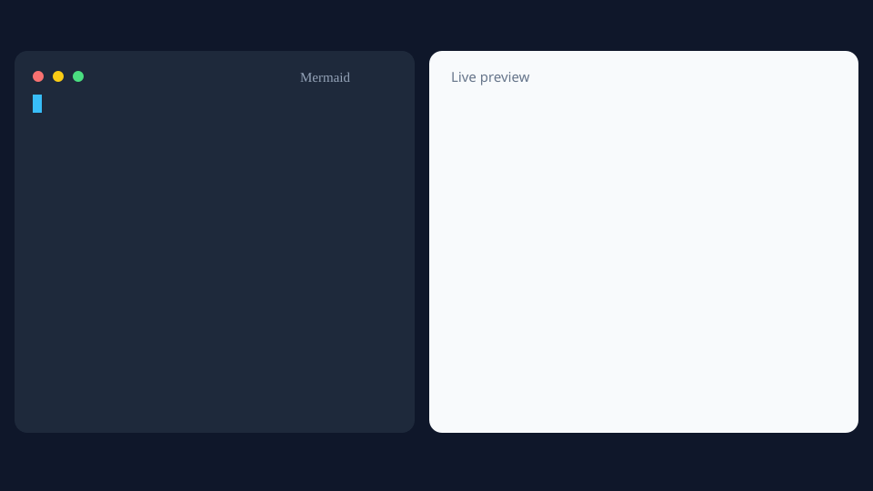

[English](README.md) | **Русский**

# Code2Graph

Редактор текстовых диаграмм с MCP-сервером для AI-агентов.

**Сайт:** [code2graph.ru](https://code2graph.ru)

[](LICENSE)
[](https://github.com/sergey-frolov-pets/code2graph/stargazers)
[](https://github.com/sergey-frolov-pets/code2graph/discussions)
[](https://github.com/sergey-frolov-pets/code2graph/releases/latest)

## Возможности

- Редактор PlantUML, Mermaid, GraphML, WireMark, D2 и Structurizr.
- Живой предпросмотр диаграммы во время правки.
- Экспорт в SVG и PNG.
- Библиотека диаграмм в браузере и REST-библиотека на серверной версии.
- MCP-сервер для Cursor и других агентов: отдаёт исходник диаграммы и изображение.
- Мастер AI и правка выделения через AI, со своим ключом или через прокси сервера.
- Статический сайт на GitHub Pages и серверная версия для самостоятельного размещения.
- Офлайн-редактирование и установка как PWA.

## Демо



## Быстрый старт

### Запуск из исходников

```bash
npm ci
npm run dev
```

Редактор открывается по адресу, который печатает Vite (порт 5173). `npm run dev:all` дополнительно поднимает API библиотеки из `server/`.

Проверки перед коммитом:

```bash
npm run typecheck:all
npm run test
npm run check:i18n
```

Статическая сборка без базы данных: `npm run build`. Подробности: [docs/DEPLOY.md](docs/DEPLOY.md).

Один HTML-файл для релиза: `npm run build:release`. Артефакт — `release/code2graph.html`. Готовые файлы лежат в [последнем релизе](https://github.com/sergey-frolov-pets/code2graph/releases/latest).

### Свой сервер

Серверная версия (вход, облачная библиотека, прокси LLM) ставится Docker Compose или скриптами из `scripts/deploy/`:

```bash
cp server/.env.example server/.env
docker compose up -d --build
```

```bash
sudo bash scripts/deploy/vdsina-install.sh
sudo bash scripts/deploy/vdsina-update.sh
```

См. [docs/DEPLOY_VDSINA.md](docs/DEPLOY_VDSINA.md) и [server/README.md](server/README.md).

### MCP-сервер в Cursor

Запускайте сервер из копии этого репозитория. Подставьте свой путь. `CODE2GRAPH_API_URL` указывает на серверную версию; токен оставьте пустым, если сервер его не требует.

```json
{
  "mcpServers": {
    "code2graph": {
      "command": "node",
      "args": ["/ABS/PATH/code2graph/packages/mcp/bin/code2graph-mcp.js"],
      "env": {
        "CODE2GRAPH_API_URL": "https://www.code2graph.ru",
        "CODE2GRAPH_API_TOKEN": "same-value-as-AGENT_API_TOKEN"
      }
    }
  }
}
```

Тот же вид подходит другим MCP-клиентам, которые запускают команду сервера. Инструменты: `list_diagram_formats`, `plan_diagram`, `generate_diagram`, `convert_diagram`. Пакет: [packages/mcp](packages/mcp).

### Ручки вывода: `size`, `detail`, `audience`

`plan_diagram` и `generate_diagram` принимают три необязательные ручки:

- `size` — рамка и типографика: `doc-inline` (960 px, 12 px, по умолчанию), `slide-16x9` (1600×900, 16 px), `social-og` (1200×630, 14 px), `print-a4` (1240×1754, 14 px). Отступы между узлами и рангами растут вместе с размером.
- `detail` — потолок детализации: `faithful` ≤24 узла, `balanced` ≤12 (по умолчанию), `simplified` ≤7. Превышение не режет схему, а возвращает предупреждение с порядком упрощения: декор → дубли → листовые кластеры → инфраструктура.
- `audience` — формулировки подписей: `engineer` (технические имена), `mixed` (простые существительные, по умолчанию), `executive` (названия результатов). Меняется только текст, не число узлов.

Размер применяется к PlantUML (`skinparam`), Mermaid (`%%{init}%%`), D2 (`d2-config.pad`); для Structurizr, GraphML и WireMark возвращается предупреждение, что подсказка размера не подключена. Неизвестное значение любой ручки — предупреждение и значение по умолчанию, без ошибки. Каждый результат содержит строку `fidelity:` — какая ручка применилась, какие счётчики не переданы и какие упрощения предложены.

## Сценарии

- Нарисовать архитектурную схему (C4, развёртывание, ArchiMate) в браузере и выгрузить SVG.
- Набросать диаграмму последовательности при разборе изменения, с живым предпросмотром.
- Попросить агента в Cursor сгенерировать диаграмму. MCP возвращает исходник, который открывается в редакторе, и изображение результата.

## Лицензия

Проект распространяется как source-available по Prosperity Public License 3.0.0.

Некоммерческое использование бесплатно и без ограничений.

Коммерческое использование бесплатно в течение 30 дней. Дальше нужна платная лицензия.

Контакт: [admin@code2graph.ru](mailto:admin@code2graph.ru)

- [LICENSE](LICENSE)
- [Prosperity Public License 3.0.0](https://prosperitylicense.com/versions/3.0.0)

Более ранние версии проекта (теги и релизы до 29 октября 2026) были под лицензией MIT. Эти разрешения безотзывные. Prosperity Public License 3.0.0 действует для всех версий начиная с коммита `b15950ac4cb3e5b6264832dff7e3698da942b2a6`.

## Сообщество

- [Discussions](https://github.com/sergey-frolov-pets/code2graph/discussions)
- [Issues](https://github.com/sergey-frolov-pets/code2graph/issues)
- [Как участвовать](CONTRIBUTING.md)
- Коммерческая лицензия: [admin@code2graph.ru](mailto:admin@code2graph.ru)

Если проект полезен — поставь ⭐, это помогает проекту.

**Сайт:** [code2graph.ru](https://code2graph.ru)
