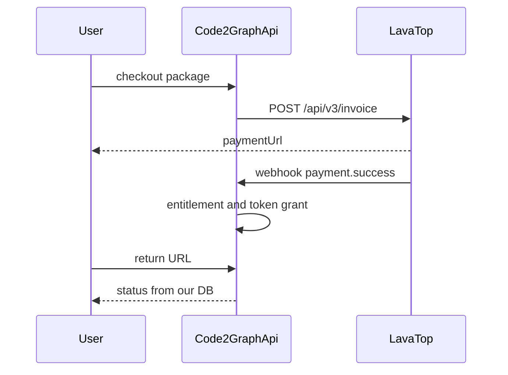

# Платные пакеты Code2Graph через lava.top

Концепция монетизации hosted-версии [code2graph.ru](https://code2graph.ru). Серверная часть живёт в `server/src/billing/`, HTTP — в `server/src/routes/billing.ts`, `billing-admin.ts` и `billing-webhook.ts`. Кабинет оператора — отдельное приложение `apps/billing-admin`.

Таблицы `subscriptions` и `user_subscriptions` в `server/src/migrations/schema-migrations.ts` выдают доступ к разделам библиотеки. Домен оплаты называется billing и эти таблицы не переиспользует.

Числа лимитов и токенов ниже — стартовые значения конфига, не цены и не обещание витрины.

## Что остаётся бесплатным

Редактор, живой предпросмотр, экспорт SVG и PNG, библиотека в браузере, PWA и AI со своим ключом (BYOK) не входят ни в один платный пакет. Статический сайт на GitHub Pages работает без кассы.

Платится то, что держит сервер `server/` на `www.code2graph.ru`: облачная библиотека, серверный LLM-прокси (`server/src/routes/llm.ts`), квоты agent API и командные места.

30 дней коммерческого использования по Prosperity Public License остаются юридическим правилом self-host и не смешиваются с этими пакетами.

## Каталог функций

Пакеты покупаются отдельно и сочетаются. Периоды lava для подписок: месяц и 12 месяцев.

### Без оплаты, на любом сайте и в PWA

Локальный продукт подпиской не закрывается.

- Языки редактора: PlantUML, Mermaid, Graphviz, D2, Structurizr, GraphML, WireMark, Ditaa.
- Живой предпросмотр, презентация, полноэкранный режим, вкладки.
- Открытие и сохранение файла, undo/redo, сниппеты, примеры, визуальный конструктор, вставка таблицы, конвертация между форматами.
- Экспорт SVG и PNG на устройстве пользователя.
- Библиотека в браузере и локальные data-link (таблица на диске или URL, который читает браузер).
- Внешний вид, офлайн и установка как PWA.
- AI со своим ключом: мастер диаграммы, правка выделения, вопрос по синтаксису. Запросы идут к провайдеру пользователя, токены Code2Graph не списываются.
- MCP `@code2graph/mcp` на машине пользователя: `list_diagram_formats`, `plan_diagram`, `generate_diagram` и локальный рендер картинки.

### Аккаунт без подписки

Регистрация на `www.code2graph.ru` даёт узкое облако.

- Вход и личный кабинет.
- До 20 облачных диаграмм и 5 разделов.
- История версий: 5 последних версий на диаграмму.
- До 3 одновременных share-ссылок, только со сроком, максимум 7 дней, право просмотра.
- Избранное, оценки и комментарии.
- Agent API (`/api/agent/*`) с низким лимитом запросов в минуту.
- Серверный LLM-прокси выключен, пока нет токенов промо, подписки AI или купленного пакета.

### Cloud

Облачная библиотека для одного человека. AI в пакет не входит. Месяц или год.

- До 500 диаграмм и 100 разделов.
- Полная история версий диаграммы.
- Постоянные share-ссылки, право скачивания, лимит числа скачиваний. Стартовый конфиг не ограничивает число активных ссылок.
- Доступ к разделу другим пользователям: просмотр, скачивание, совместное редактирование, со сроком или бессрочно.
- Наборы библиотеки (текущие `subscriptions`): автор собирает разделы и диаграммы и выдаёт их людям или по ссылке.
- Перенос облачной библиотеки (выгрузка и загрузка).
- Тот же локальный редактор и BYOK, что и без оплаты.

### AI Proxy

Оплата серверных моделей. Cloud докупается отдельно. Месяц или год.

- `POST /api/llm/chat` на ключах сервера: Gemini, Groq, OpenRouter.
- Мастер, правка выделения и вопрос по синтаксису через этот прокси.
- Ежемесячный сгораемый грант в бакет `included`. Стартово 300 токенов в месяц. Годовая подписка начисляет тот же месячный грант каждый оплаченный месяц, а не 12 грантов сразу.
- Потолок ответа (`LLM_MAX_OUTPUT_TOKENS`) и лимит запросов в минуту выше, чем у разовых токенов.
- Свой ключ по-прежнему без списания токенов Code2Graph.

### Пакеты токенов

Разовая покупка, не подписка. Новых экранов не открывает. Пополняет бакет `purchased`.

- Можно купить без подписки AI: прокси работает, пока баланс больше нуля, с более низким лимитом запросов и более коротким ответом.
- При активной подписке AI сначала списывается `included`, затем `purchased`.
- Баланс не сгорает и переживает окончание подписки и промо.
- Стартовые номиналы витрины: 100, 500 и 2000 токенов. Цена единицы задаётся продуктом lava. Стоимость одного хода мастера задаётся конфигом по `providerId`.

### Team

Общая библиотека. Платит владелец организации. Стартовые офферы: 5 и 15 мест, месяц или год.

- Каждое занятое место получает функции Cloud.
- Общие разделы, приглашение по одноразовой ссылке, роли владельца и участника. Снятие участника нового платежа не создаёт. Email приглашённого не сохраняется.
- Наборы библиотеки и права на разделы действуют внутри организации.
- Общий месячный грант токенов (стартово 300 на место) и общие купленные пакеты.
- Владелец видит журнал списаний по участникам.
- Личный пакет AI в командный не превращается. Личные купленные токены остаются на личном счёте.

### Enterprise

Самостоятельной оплаты нет. Заявка уходит письмом на `admin@code2graph.ru` и в базу не пишется. В SQLite для такого счёта остаются `user_id` уже вошедшего пользователя, желаемое число мест и набор флагов.

- Всё, что в Team, с числом мест из договора.
- Объём токенов и лимиты LLM из договора.
- Набор флагов функций в админке, без отдельной ветки кода под клиента.
- Счёт lava «цена по запросу» (`amount` и `currency`) либо оплата вне lava и ручное включение доступа.
- Коммерческий self-host по Prosperity Public License — отдельная строка договора. В облачные пакеты она сама не входит.
- Почта поддержки с приоритетом. SSO в первую версию не входит.

### Промо и подарок

- Промо один раз на аккаунт, 14 дней, без карты: лимиты Cloud и 50 токенов в `included`. Team и Enterprise промо не включает. После срока остаётся уровень аккаунта без подписки. Купленные токены сохраняются. Это первая кампания кабинета оператора, а не отдельный механизм.
- Подарок: месяц или год Cloud, пакет токенов, предоплаченные месяцы Team. Даритель копирует код и передаёт его сам. Получатель активирует код в своём аккаунте. Email получателя не запрашивается и не сохраняется. Enterprise не дарится. Продления с карты дарителя нет.

## Токены

Два бакета на счёте пользователя или организации.

- `included` — промо и ежемесячный грант подписки AI или Team. Сгорает в конце периода.
- `purchased` — разовые пакеты и подаренные токены. Не сгорает. Списывается вторым.

Журнал `token_ledger` только дополняется: грант, покупка, подарок, списание, возврат, истечение. Списание идемпотентно по id запроса. Ошибка провайдера токены не списывает. Стоимость хода задаётся конфигом по `providerId`. Нулевой баланс отвечает 402 и редактор не блокирует.

## Сценарии

### Промо

У lava нет бесплатного trial. Срок живёт в `billing_entitlements` со статусом `trialing`. Карта не привязывается, инвойс не создаётся. По окончании доступ Cloud и AI сужается до бесплатного лимита. Конверсия — обычный инвойс lava.

### Покупка

Пользователь выбирает пакет. Сервер создаёт контракт в lava и сохраняет id инвойса вместе с `user_id` и `offerId`. Доступ выдаёт webhook `payment.success` (первый платёж подписки и разовая покупка токенов или подарка). Возврат на сайт с `invoiceId` и `status` доступ не включает: параметр в адресе можно подделать. При необходимости сервер сверяет статус через `GET /api/v1/invoices/{id}`.

### Продление

`subscription.recurring.payment.success` сдвигает конец периода и начисляет очередной грант `included`. Повтор того же контракта срок дважды не продлевает.

### Неуспешное списание

Lava делает ещё две попытки, через 8 и 24 часа, и шлёт webhook только по последней. До `subscription.cancelled` доступ и места работают. Статус на этот промежуток — `past_due`.

### Отмена

Автор отменяет подписку через `DELETE /api/v1/subscriptions`. Событие `subscription.cancelled` оставляет доступ до `willExpireAt`. Новых списаний нет.

### Возврат и чарджбэк

`refund.success` и `chargeback.initiated` гасят неактивированный подарок и уже выданный срок, если lava помечает подписку отменённой. Токены, начисленные этим платежом и ещё не потраченные, списываются обратной записью журнала. Уже потраченные токены отдельным штрафом не доначисляются.

### Подарок

Разовый цифровой продукт, не рекуррентная подписка. До webhook создаётся `gift_grants` с id инвойса и хэшем кода, без контакта получателя. `payment.success` показывает код один раз. Получатель, уже войдя в аккаунт, активирует код: записывается его `user_id`, доступ конечный. Возврат гасит неактивированный код и уже выданный срок.

### Команда

Владелец — покупатель lava. Приглашение — одноразовая ссылка, в базе её хэш. Принявший приглашение занимает место своим `user_id`. Смена состава нового платежа не создаёт. Общий бакет токенов организации. Отмена сохраняет доступ до `willExpireAt`.

### Enterprise

Письмо на `admin@code2graph.ru` контакт в SQLite не пишет. После договора оператор вручную выдаёт entitlement из кабинета. Счёт с произвольной суммой — `POST /api/v3/invoice` с продуктом «цена по запросу». Оплата вне lava тоже включается вручную, без инвойса.

## lava.top

В кабинете lava заводятся офферы. В SQLite `billing_offers` хранит соответствие `offerId` пакету, периоду, токенам и местам.

Сервер создаёт контракт `POST https://gate.lava.top/api/v3/invoice`: email только в этом исходящем запросе, `offerId`, для enterprise ещё `amount` и `currency`, адреса возврата только `https` и не длиннее 512 символов. Email нужен lava и в базу, лог и аудит не записывается. Из ответа lava сохраняется id контракта, а не карточка покупателя.

Webhook: `POST /api/billing/lava/webhook`, заголовок `X-Api-Key`.

- `payment.success`
- `payment.failed`
- `subscription.recurring.payment.success`
- `subscription.recurring.payment.failed`
- `subscription.cancelled`
- `refund.success`
- `chargeback.initiated`

Ответ 2xx быстрее 10 секунд. Незнакомое событие тоже получает 2xx, иначе lava повторяет доставку. Идемпотентность — по id контракта или инвойса. Неверный ключ даёт 401, тело запроса в лог не пишется.

## Схема данных

Связь с человеком — `user_id` из уже существующей таблицы `users`. Копии логина, email, имени, телефона и адреса в этих таблицах нет.

- `billing_accounts`. Счёт пользователя или организации: остатки `included` и `purchased`, момент сгорания `included`.
- `billing_entitlements`. Пакет (`cloud`, `ai`, `team`, `enterprise`), статус (`trialing`, `active`, `past_due`, `canceled`, `gifted`), конец периода, id контракта lava, источник (покупка, промо, подарок, ручная выдача).
- `billing_offers`. `offerId` lava, пакет, период, токены гранта, число мест.
- `token_ledger`. Добавляемые записи: тип, бакет, величина, id запроса, `user_id` или id организации, id контракта, если запись пришла из оплаты.
- `gift_grants`. Хэш кода, id инвойса, пакет, срок или номинал токенов, `user_id` дарителя, `user_id` получателя после активации.
- `organizations`. Название, `user_id` владельца, потолок мест.
- `organization_members`. Id организации, `user_id`, роль (`owner`, `member`).
- `organization_invites`. Хэш ссылки, id организации, срок. Контакта приглашённого нет.
- `lava_events`. Тип, id контракта, сумма, валюта, `offerId`, статус. Объекта покупателя и сырого JSON нет.
- `billing_campaigns`. Название, окно, правило аудитории (новые аккаунты или явные `user_id`), пакет и срок, число токенов, один раз на аккаунт, статус (`draft`, `running`, `paused`, `ended`).
- `billing_campaign_grants`. Id кампании, `user_id`, момент начисления.
- `billing_audit`. `user_id` администратора, код действия, id сущности, время. Свободного текста и контактных данных нет. Срок хранения задаётся конфигом.

Причина ручной операции — код из фиксированного списка (`support_grant`, `support_revoke`, `enterprise_contract`, `token_adjustment`, `gift_revoke`).

## Минимум персональных данных

В биллинге нет колонок email, имени, телефона и адреса. Логин уже хранит `username` и хэш пароля в `users`. Таблицы оплаты на них ссылаются через `user_id` и копию логина не делают.

- На оплате email вводится в форме и уходит в `POST /api/v3/invoice`. После ответа lava поле отбрасывается.
- Тело webhook разбирается в памяти. В `lava_events` пишутся только поля из схемы выше.
- Подарок и приглашение в команду — одноразовый код. До активации известен хэш. После активации записывается `user_id` того, кто вошёл и применил код.
- Кампания выбирает новых пользователей или список `user_id`. Загрузка адресов не принимается.
- Заявка Enterprise уходит на почту и контакт в SQLite не пишет.
- Статистика и CSV — суммы и счётчики.
- Кабинет, чтобы показать строку подписки, читает `username` из `users` в момент запроса. В экспорт это значение не попадает.

Платёжная страница lava получает email покупателя. Это хранилище lava, не база Code2Graph. Номер карты Code2Graph не видит и не хранит.

## Защита сведений о подписках

Редактор получает только собственный доступ к функциям. Платёжные записи и операторские списки остаются в контуре кабинета.

Экранирование доступа:

- Маршруты библиотеки, шаринга и редактора не соединяют свои запросы с таблицами биллинга. Свой срез отдаёт `GET /api/billing/me`: флаги пакетов, свои лимиты и свой остаток токенов.
- В этот срез не входят чужие аккаунты, суммы, id контракта lava, аудитория кампаний и чужой журнал списаний.
- `/api/billing-admin/*` отвечает только после проверки роли `admin`. Остальным — отказ без списка записей.
- Кабинет не попадает в бандл редактора и не ссылается из шапки сайта. Nginx отдаёт `/billing/` только по HTTPS. Поверх логина приложения, если хостинг позволяет, ставится второй барьер: список IP или basic auth на этот location.
- Участник Team видит название организации, свою роль и общий остаток токенов. Журнал других участников и платёж владельца видят владелец организации и `admin`.
- Подарочный код и ссылка приглашения показываются один раз при выпуске.

Экранирование отображения:

- Названия кампаний и логины выводятся как текст. `v-html` для этих полей не используется.
- В логах сервера нет `X-Api-Key`, `LAVA_API_KEY`, кодов подарков, email и полного JSON webhook.

Хранение:

- `billing_audit` фиксирует выдачу и снятие подписки, изменение токенов, запуск и остановку кампании.
- Файл SQLite доступен только пользователю процесса Node. Копии базы с биллингом в git не попадают. Резервная копия шифруется.

## Кабинет оператора

Отдельное приложение `apps/billing-admin`, свой Vite-проект на Vue. В редактор диаграмм и в публичный сайт оно не входит и из них не открывается. Роль доступа — существующий `admin` (`server/src/routes/admin.ts`). Библиотечный экран пользователей остаётся в редакторе. Оплата, кампании и отчёты живут только в кабинете.

API — `/api/billing-admin/*` на том же процессе Node. Браузер кабинета ключ lava не видит. Выдача и отъём прав пишутся в те же `billing_entitlements` и `token_ledger`, что и webhook.

Экраны:

- **Подписки.** Пакет, статус, конец периода, id контракта lava, места, бакеты токенов. Фильтры по пакету и статусу. Действия: выдать и снять доступ, дописать или списать токены с кодом причины, погасить подарок, отменить продление через `DELETE /api/v1/subscriptions`. Ручная выдача — путь для Enterprise и поддержки.
- **Кампании.** Название, окно, аудитория, выдача, признак «один раз на аккаунт», статус. Списка email нет. Запуск переводит кампанию в `running`. Сервер начисляет грант при регистрации или при явном включении `user_id`. 14 дней Cloud и 50 токенов — первая запись, не отдельная ветка кода. Рекуррентный контракт lava кампания не создаёт.
- **Статистика.** Период на выбор. Активные подписки по пакетам, успешные и неуспешные продления, отмены, возвраты, суммы, начисленные и потраченные токены, остатки бакетов, воронка кампании, куплено и активировано подарков. Суммы берутся из `lava_events`, без запроса в lava на каждый просмотр. CSV содержит те же числа, без пользователей и без платёжных идентификаторов.

Сборка кладётся на тот же VPS nginx, location `/billing/` или поддомен `billing.code2graph.ru`. GitHub Pages этот кабинет не публикует.

## Где разворачивать

Касса и webhook — в текущем процессе Node на VPS VDSina (`www.code2graph.ru`, nginx, SQLite). Пользователи и LLM-прокси уже там. Секреты `LAVA_API_KEY` и `LAVA_WEBHOOK_KEY` только в `server/.env`.

GitHub Pages секреты и входящие webhook не принимает.

Перед включением оплаты — регулярная шифрованная копия `library.db`. Отдельный биллинг-сервис и Postgres имеют смысл, когда появятся параллельные списания команд, не в первой версии.

## Вне первой версии

Промокоды lava, скидки, смена тарифа в середине периода, SSO и отдельная роль биллинг-оператора в первую версию не входят.
