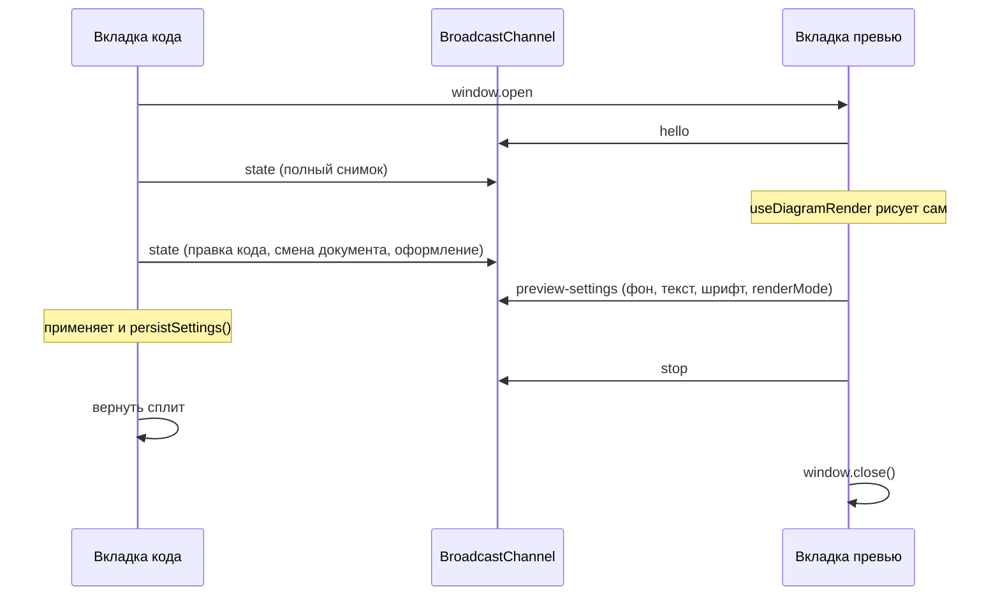

# План: двухэкранный режим (код и превью в разных вкладках)

Статус: **реализовано** — кнопка в шапке превью открывает `#/preview/<sessionId>`, синхронизация через `BroadcastChannel`.

## 1. Что делаем

Кнопка в шапке блока «Просмотр» (`DiagramPreview`) включает и выключает двухэкранный режим:

- текущая вкладка остаётся вкладкой **кода** (редактор на всю ширину, панель превью и разделитель скрыты);
- новая вкладка того же origin — вкладка **превью** (только `DiagramPreview`, свой рендер);
- повторное нажатие той же кнопки уже во вкладке превью возвращает сплит в редакторе и закрывает вкладку превью.

Режим живёт в памяти сессии. Перезагрузка редактора его не восстанавливает: после F5 снова обычный сплит.

На узкой раскладке (`< 901px`) кнопки нет: там уже переключатель «код / превью» (`ResponsivePanelTabs` + `PreviewFab`).

## 2. Почему не localStorage

`usePersistedSettings.persistSettings()` пишет `STORAGE_KEY_SOURCE` и оформление. Вторая вкладка с полным `useAppShell()`:

- прочитает тот же source и начнёт писать его обратно;
- поднимет свои документы редактора, буфер обмена и диалог источника данных.

Поэтому превью — отдельный маршрут и отдельный boot. Синхронизация только через `BroadcastChannel`. В `localStorage` по-прежнему пишет только вкладка редактора.

Превью **не** получает готовый SVG. Оно получает вход рендера и само вызывает `useDiagramRender` (дебаунс, онлайн/офлайн-движки, кэш IR остаются как есть). Масштаб и пан (`usePreviewPanZoom`) и размер картинки (`useImageSize`) локальны для вкладки превью.

## 3. Роли и маршрут

| Роль | Где | Поведение |
| --- | --- | --- |
| `editor` | текущий `#/app`, а также `/local/…` и clipboard, которые монтируют `App.vue` | Хост сессии. Единственный, кто пишет настройки. Публикует состояние активного документа. |
| `preview` | `#/preview/<sessionId>` | Подписчик. Своего source в storage не пишет. Рисует диаграмму. |

`sessionId` — случайный идентификатор на включение режима. В канал попадают только сообщения с тем же id, чтобы вторая вкладка редактора не перехватила чужую сессию.

Разбор хеша — в `parseRouteFromHash` (`src/router.ts`):

- имя маршрута `preview`;
- `diagramSlug` переиспользуем как поле сессии (отдельное поле не заводим);
- `#/preview` без id — невалидный маршрут, остаётся landing, как сейчас для неизвестных хешей;
- `routeHash` для `preview` не нужен: URL собирает хост.

`Root.vue` для `preview` монтирует новую страницу `src/pages/PreviewPage.vue`, не `App.vue`.

Открытие вкладки:

```ts
window.open(`${location.pathname}${location.search}#/preview/${sessionId}`, "code2graph-preview");
```

Имя окна фиксированное: повторное включение фокусирует уже открытую вкладку, вторую не создаёт. `noopener` не ставим — нужна ссылка `Window`, чтобы фокусировать и закрывать вкладку. Если `window.open` вернул `null` (блокировщик), режим не включается, сплит остаётся, пользователю показывается уже существующий `alert` приложения.

## 4. Кнопка

Новый `src/components/PanelDualScreenButton.vue` по образцу `PanelFullscreenButton.vue`: `IconButton`, `pressed`, подпись из локалей.

Место: шапка `DiagramPreview.vue`, сразу перед `PanelFullscreenButton`. Иконка — два прямоугольника (Lucide `columns-2`), в активном состоянии та же иконка с `aria-pressed="true"`.

Строки в `src/locales/{ru,en}/misc.ts`:

- `preview.dualScreen.enter` — «Превью в другой вкладке» / «Preview in another tab»;
- `preview.dualScreen.exit` — «Вернуть превью сюда» / «Bring preview back»;
- `preview.dualScreen.blocked` — «Браузер заблокировал новую вкладку» / «The browser blocked the new tab»;
- `preview.dualScreen.editorGone` — «Вкладка с кодом закрыта» / «The code tab was closed».

Во вкладке редактора после отсоединения панели превью нет, поэтому выключение делается кнопкой во вкладке превью. Это и есть запрошенный контракт.

Полноэкранный режим панели (`isFullscreen`) при включении двухэкранного режима сбрасывается: вкладка превью и так занимает окно. `expandSignal` от привязки данных в отсоединённом режиме игнорируется.

## 5. Протокол канала

Файл `src/composables/useDualScreenSession.ts`, константы в `src/constants/dual-screen.ts`.

- имя канала: `code2graph-dual-screen`;
- heartbeat: `2000` мс;
- считаем вкладку потерянной после `3` пропущенных ответов.

Сообщение:

```ts
type DualScreenMessage =
  | { type: "hello"; sessionId: string }
  | { type: "state"; sessionId: string; state: DualScreenState }
  | { type: "preview-settings"; sessionId: string; settings: DualScreenPreviewSettings }
  | { type: "stop"; sessionId: string; from: "editor" | "preview" }
  | { type: "ping"; sessionId: string }
  | { type: "pong"; sessionId: string };

interface DualScreenState {
  source: string;
  diagramFormat: DiagramFormat;
  layout: LayoutEngine;
  renderMode: RenderMode;
  diagramDarkMode: boolean;
  previewBackground: string;
  diagramTextColor: string;
  diagramFontFamily: string;
  diagramFontWeight: string;
  diagramFontStyle: string;
}
```

`DualScreenPreviewSettings` — срез оформления и `renderMode` (то, что меняется тулбаром превью и окном «Внешний вид»).

Последовательность:



Правила:

1. Хост шлёт полный `state` на `hello` и на каждое изменение полей снимка. На keystroke срабатывает тот же дебаунс, что у рендера (`RENDER_DEBOUNCE_MS`), чтобы не слать source на каждый символ дважды с разной частотой. Смена документа редактора шлётся сразу.
2. Превью применяет `state` в свои `ref` и не вызывает `persistSettings`. Пока идёт применение входящего снимка, обратный `preview-settings` не шлётся (флаг `applyingRemote`).
3. Правка оформления во вкладке превью уходит как `preview-settings`. Хост записывает её в свои ref — сработает существующий `persistSettings`.
4. `stop` с любой стороны гасит режим. Превью закрывает себя через `window.close()`. Если браузер не дал закрыть вкладку, страница остаётся с текстом `preview.dualScreen.exit` уже в выключенном состоянии и кнопкой «закрыть» не требуется: кнопка просто снова неактивна, пользователь закрывает вкладку сам. Хост в этот момент уже вернул сплит.
5. Хост пингует превью. Нет `pong` три раза подряд или `previewWindow.closed === true` — хост сам возвращает сплит. Так обрабатывается крестик вкладки, у которого `pagehide` может не успеть послать `stop`.
6. Превью пингует хост. Нет ответа — вместо диаграммы текст `preview.dualScreen.editorGone`. Канал на этой странице закрывается, в storage ничего не пишется.
7. Обновление вкладки превью: страница снова шлёт `hello`. Живой хост отвечает `state`. Хост уже выключен — превью остаётся на `editorGone`.
8. Обновление вкладки кода сбрасывает сессию (id был в памяти). Старая вкладка превью получает тишину и показывает `editorGone`.

Экспорт SVG/PNG и копирование PNG остаются во вкладке превью: у неё свой `svg` после локального рендера. Обработчики экспорта выносятся в переиспользуемые функции, которые уже есть в `useDiagramExport`, и вызываются со страницы превью с её `svg`. Сохранение в библиотеку, вкладки документов, LLM и мастер во вкладке превью не показываются.

## 6. Как меняется текущий layout

`App.vue`:

- флаг `previewDetached` из composable;
- класс `app-main--preview-detached` на `<main>`;
- `DiagramPreview` и `.app-split-divider` не рендерятся, пока флаг включён;
- стиль панели редактора в этом режиме не берётся из `editorPaneStyle` (ширина 100%);
- `ResponsivePanelTabs` и `PreviewFab` скрыты, `activeMobilePanel` принудительно `"editor"`.

`PreviewPage.vue`:

- шапка только с заголовком «Просмотр», тулбаром диаграммы и кнопкой двухэкранного режима;
- тело — тот же viewport, что в `DiagramPreview` (ошибка, загрузка, svg, placeholder);
- без `AppHeader`, вкладок документов, статус-бара редактора и модалок библиотеки;
- тема интерфейса читается из уже сохранённого `STORAGE_KEY_UI_DARK`, чтобы тёмная тема совпала, но превью её не перезаписывает.

Чтобы не дублировать разметку viewport, из `DiagramPreview.vue` наружу добавляется необязательный prop `dualScreen`:

- `role: "editor" | "preview"`;
- `active: boolean`;
- `onToggle`.

Страница превью рендерит `DiagramPreview` с уже посчитанными `svg` / `error` / `isRendering` и этим prop. Редактор передаёт тот же prop, пока панель ещё на месте (до отсоединения кнопка видна, после — панели нет).

`shell-layout.css`: для `.app-main--preview-detached` одна колонка, разделитель не нужен. Класс `.panel-header__dual-screen` копирует размеры `.panel-header__fullscreen` (32×32).

## 7. Файлы

Новые:

- `src/constants/dual-screen.ts` — имя канала, интервал heartbeat, порог пропуска, имя окна;
- `src/composables/useDualScreenSession.ts` — хост и подписчик, типы сообщений;
- `src/pages/PreviewPage.vue` — тонкая страница превью;
- `src/components/PanelDualScreenButton.vue`;
- `src/composables/useDualScreenSession.test.ts`.

Правки:

- `src/router.ts`, `src/router.test.ts` — маршрут `#/preview/<sessionId>`;
- `src/Root.vue` — ветка `preview`;
- `src/App.vue` — скрытие превью и разделителя;
- `src/components/DiagramPreview.vue` — кнопка и сброс fullscreen;
- `src/styles/shell-layout.css` — колонка на всю ширину и размер кнопки;
- `src/locales/ru/misc.ts`, `src/locales/en/misc.ts`.

`useAppShell` не становится каналом. Хост создаётся в `App.vue` и читает из shell только снимок. Так страница превью не тянет библиотеку, историю и вкладки документов.

## 8. Порядок реализации

1. Константы, типы сообщений и `useDualScreenSession` с тестами на фиктивном `BroadcastChannel`: hello → state, игнор чужого `sessionId`, stop, три пропущенных pong.
2. Маршрут `#/preview/<id>` и тест в `router.test.ts`. Неизвестный `#/preview` без id по-прежнему landing.
3. `PreviewPage`: boot движка через `useDiagramRender` без `onPersist`, применение `state`, отправка `preview-settings`, экран `editorGone`.
4. Кнопка в `DiagramPreview` и класс отсоединённого layout в `App.vue`. Блокировка `window.open` не меняет layout.
5. Строки ru/en.
6. Ручная проверка в двух окнах браузера: включение, правка кода, смена вкладки документа, смена фона в превью (сохраняется после выключения), крестик вкладки превью, крестик вкладки кода, блокировщик попапов.

## 9. Что сознательно не входит

- Синхронизация панорамирования и зума.
- Восстановление режима после перезагрузки редактора.
- Третья вкладка превью на ту же сессию: имя окна одно, второй `window.open` фокусирует первую.
- Отдельная раскладка для установленного PWA. `window.open` откроет обычную вкладку браузера — этого достаточно.
