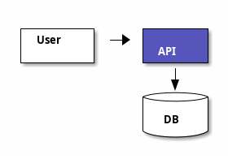

# ditaa diagram: instructions for LLM agents

You are writing a ditaa diagram: ASCII art that becomes boxes and arrows. In this app, wrap it so PlantUML can render it. Emit the diagram source only.

Rules:

- Use `@startditaa` / `@endditaa`. Do not use `@startuml`.
- A rectangle uses `+` corners, `-` horizontal edges, and `|` vertical edges. Keep columns aligned.
- Arrows are `-->`, `<--`, and `v` or `^` on a vertical stem. Leave a space between the box edge and the arrow.
- A color tag is the first token inside the box: `cRED`, `cBLU`, `cGRE`, `cPNK`, `cYEL`, `cBLK`, `cWHI`.
- Shape tags sit in braces on their own line inside the box: `{d}` document, `{s}` storage, `{io}` input/output, `{o}` ellipse, `{c}` decision.
- The readable label is the text on the following lines inside the same box.
- Do not mix PlantUML `participant` or Mermaid keywords into the ASCII.
- Match the user's language in the text inside boxes.
