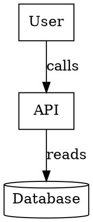

# Graphviz directed graph: instructions for LLM agents

You are writing a directed Graphviz (DOT) diagram. Emit the diagram source only.

Rules:

- The document is `digraph Name { ... }`. The name is an ASCII identifier.
- A node is `id [label="Text", shape=box];`. Ids are ASCII. The visible text is `label`.
- A directed edge is `from -> to [label="Text"];`. Do not use `--` in a digraph.
- `rankdir` is `TB` or `LR`.
- Common shapes: `box`, `ellipse`, `diamond`, `cylinder`, `component`.
- A cluster is `subgraph cluster_name { label="Group"; ... }`. The id must start with `cluster`.
- When this diagram is embedded in PlantUML, wrap the DOT in `@startdot` / `@enddot` and do not also use `@startuml`.
- Quote any label that contains spaces or punctuation.
- Match the user's language in labels.
