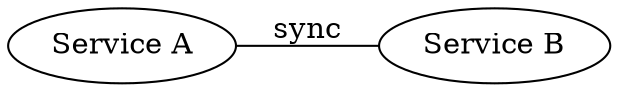

# Graphviz undirected graph: instructions for LLM agents

You are writing an undirected Graphviz (DOT) diagram. Emit the diagram source only.

Rules:

- The document is `graph Name { ... }`, not `digraph`, when the edges have no direction.
- An edge is `a -- b [label="Text"];`. Do not use `->`.
- Node ids are ASCII. Put spaces inside `label="..."`.
- `rankdir` is `TB` or `LR`.
- A cluster is `subgraph cluster_name { label="Group"; ... }`.
- When this diagram is embedded in PlantUML, wrap the DOT in `@startdot` / `@enddot`.
- Match the user's language in labels.
