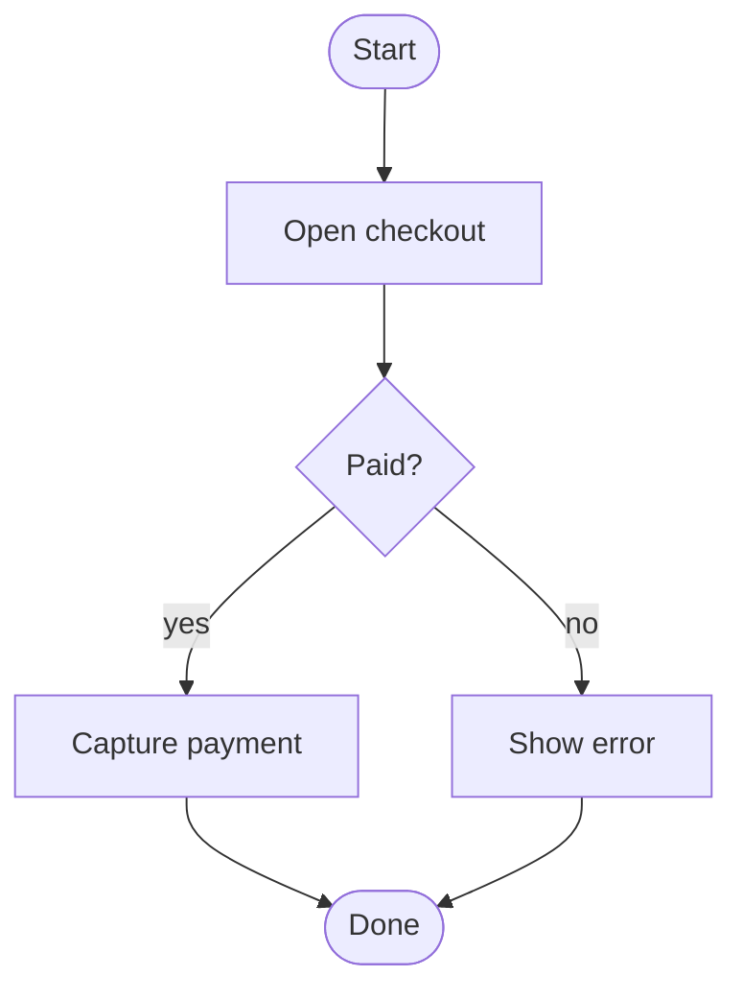

# Mermaid activity: instructions for LLM agents

You are writing an activity flow in Mermaid. Mermaid has no separate activity keyword: express it as a flowchart. Emit the diagram source only.

Rules:

- The first line is `flowchart TD` or `flowchart LR`. Do not emit `@startuml` or PlantUML `:step;` lines.
- Start and end are stadiums: `start([Start])`, `stop([Done])`.
- A step is `id[Label]`. A decision is `id{Question?}`.
- Every decision needs labeled branches: `paid -->|yes| s2` and `paid -->|no| s3`.
- Parallel work is a fork node with two outgoing edges, then both paths join the next step.
- Swimlanes are subgraphs, one per actor: `subgraph customer [Customer]` / `end`.
- Node ids stay ASCII (`s1`, `paid`). Visible text goes inside the brackets.
- Match the user's language in labels.
