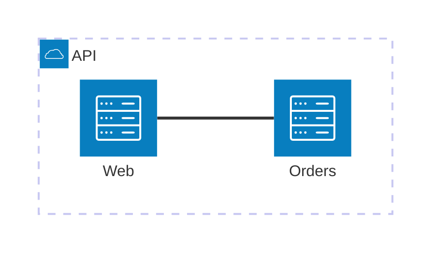

# Mermaid architecture: instructions for LLM agents

You are writing a Mermaid architecture diagram (`architecture-beta`). Emit the diagram source only.

Rules:

- The first line is `architecture-beta`.
- A group is `group id(icon)[Label]`. A service is `service id(icon)[Label]` and may add `in groupId`.
- Ids are ASCII identifiers (`web`, `orders`). Icons are short names such as `cloud`, `server`, `database`, `disk`.
- Bracket labels are ASCII. If the user wrote a non-ASCII label, transliterate it to ASCII in the brackets and keep the original wording only if it is plain ASCII.
- An edge names sides: `id:R -- L:other` where the side is `L`, `R`, `T`, or `B`.
- Indent services that belong to a group by four extra spaces.
- Do not use C4 macros or `flowchart` nodes in this diagram.
- Match the user's language only when the label stays ASCII; otherwise use a readable ASCII label.
