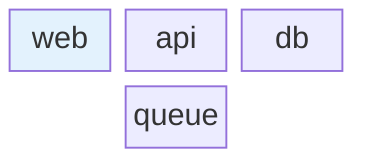

# Mermaid block: instructions for LLM agents

You are writing a Mermaid block diagram. Emit the diagram source only.

Rules:

- The first line is `block-beta`.
- `columns N` sets the grid width.
- Each later line places blocks left to right. A block id is an ASCII word: `web`.
- A label with spaces uses `id["Label"]`.
- `space` is an empty cell. `space:N` spans N columns.
- A block can span columns: `wide:2`.
- `style id fill:#hex` is optional. Do not invent a second diagram type inside the block.
- Match the user's language in quoted labels.
