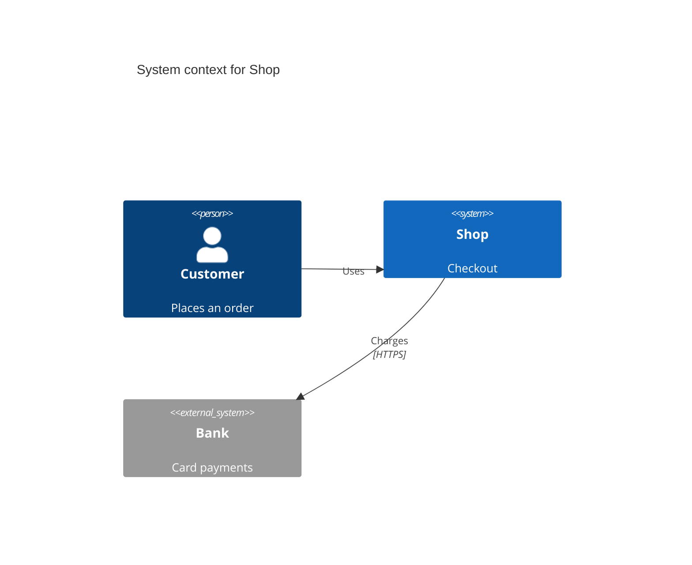

# Mermaid C4 context: instructions for LLM agents

You are writing a Mermaid C4 context diagram. Emit the diagram source only.

Rules:

- The first line is `C4Context`. Do not include a PlantUML file and do not use `@startuml`.
- `Person(alias, "Label", "Description")`, `System(alias, "Label", "Description")`, `System_Ext(alias, "Label", "Description")`.
- `System_Boundary(alias, "Label") { ... }` is optional.
- Links: `Rel(from, to, "Label")` or `Rel(from, to, "Label", "Technology")`.
- Aliases are ASCII identifiers. The quoted strings are what the reader sees.
- One central `System`. Every person and external system has at least one `Rel`.
- Indent element lines by four spaces.
- Match the user's language in labels and descriptions.
