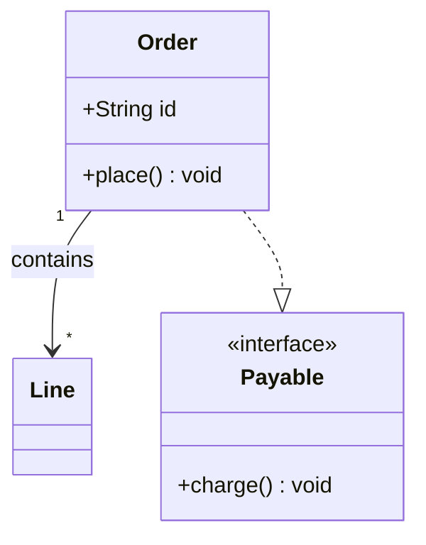

# Mermaid class: instructions for LLM agents

You are writing a Mermaid class diagram. Emit the diagram source only.

Rules:

- The first line is `classDiagram`.
- Set direction with `direction TB` or `direction LR` when the user asked for a layout.
- Members live in `class Name {` / `}`. Visibility prefixes are `+`, `-`, `#`, `~`.
- Relationships: `<|--` inheritance, `*--` composition, `o--` aggregation, `-->` association, `..>` dependency, `..|>` realization.
- Cardinality is quoted on the arrow: `"1" --> "*"`.
- A namespace is `namespace Name { ... }`.
- Notes: `note for Order "text"`.
- Do not use PlantUML `class Name { +field: Type }` colon syntax inside the body; Mermaid members are `+Type name` or `+name() return`.
- Match the user's language in class names when they are domain words. Prefer ASCII identifiers if a name has spaces, and set the label with `class Alias["Label"]`.
