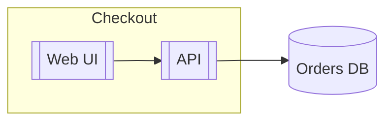

# Mermaid component: instructions for LLM agents

You are writing a component diagram in Mermaid. Express components as a flowchart. Emit the diagram source only.

Rules:

- The first line is `flowchart TD` or `flowchart LR`.
- A component is `id[[Label]]` (subroutine shape). A database is `id[(Label)]`.
- Group a system in `subgraph id [Title]` / `end`.
- Dependencies are `-->`. Label a protocol with `-->|HTTPS|`.
- An interface can be a stadium `id([REST])` with a dotted link `iface -.-> api`.
- Node ids are ASCII. Do not put spaces in the id.
- Do not use PlantUML `[Component]` brackets as the whole line, and do not use C4 `Container()` macros here.
- Match the user's language in labels.
