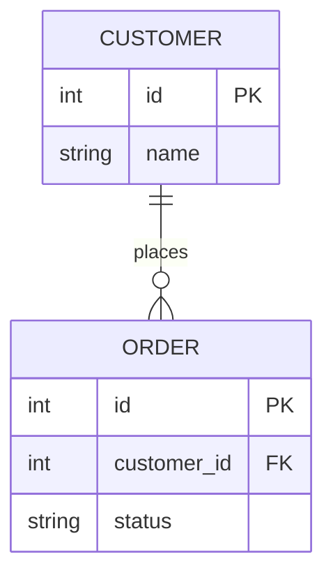

# Mermaid ER: instructions for LLM agents

You are writing a Mermaid entity-relationship diagram. Emit the diagram source only.

Rules:

- The first line is `erDiagram`.
- Entity names are identifiers, usually UPPER_SNAKE. Do not put spaces in the name.
- Attributes live in `NAME {` / `}`. Each attribute is `type name` plus optional `PK`, `FK`, or `UK`.
- A relationship is `A ||--o{ B : label`.
- Cardinality tokens: `||` exactly one, `|o` zero or one, `}|` one or more, `}o` zero or more. The side next to the entity describes that entity.
- The relationship label is required and sits after the colon. Quote it if it contains spaces: `: "placed by"`.
- Do not use PlantUML `entity` blocks or `*` key markers.
- Match the user's language in relationship labels. Keep entity identifiers ASCII.
