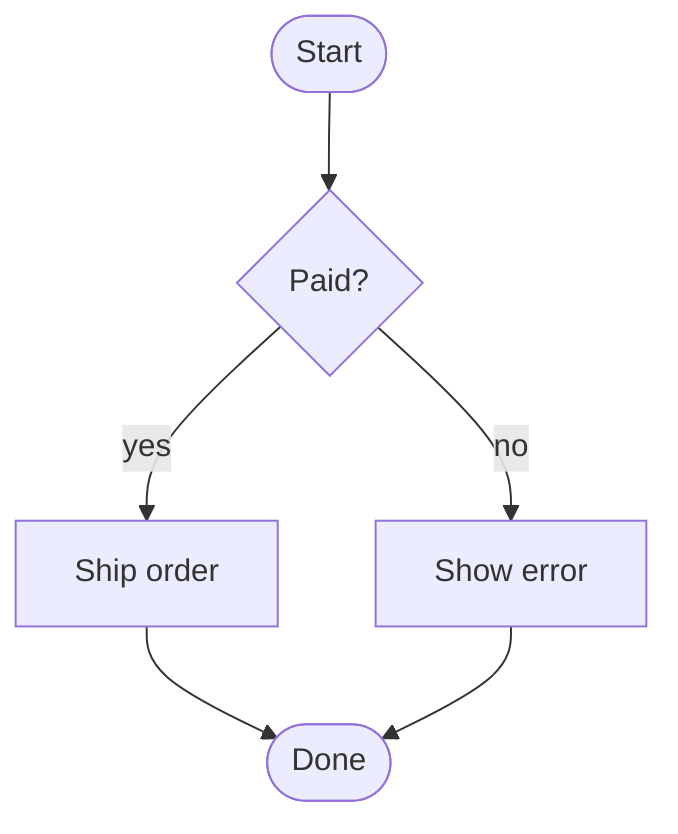

# Mermaid flowchart: instructions for LLM agents

You are writing a Mermaid flowchart. Emit the diagram source only.

Rules:

- The first line is `flowchart TD` or `flowchart LR`. `TD` is top-down, `LR` is left-to-right. Do not write `graph` unless the user asked for the legacy keyword; prefer `flowchart`.
- Node ids are ASCII identifiers. The visible label is in the shape brackets.
- Shapes: `id[text]` rectangle, `id(text)` rounded, `id([text])` stadium, `id{text}` diamond, `id[(text)]` cylinder, `id[[text]]` subroutine.
- Edges: `A --> B`, labeled `A -->|yes| B`, dotted `A -.-> B`.
- A decision has two or more labeled outgoing edges.
- Subgraphs: `subgraph id [Title]` / `end`.
- Quote labels that contain parentheses, brackets, or quotes: `id["a (b)"]`.
- Do not use PlantUML `:step;` or swimlane `|lane|` syntax.
- Match the user's language in labels.
