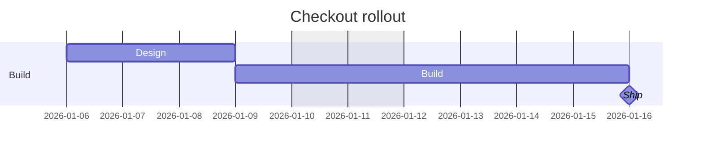

# Mermaid Gantt: instructions for LLM agents

You are writing a Mermaid Gantt chart. Emit the diagram source only.

Rules:

- The first line is `gantt`.
- `title`, `dateFormat YYYY-MM-DD`, and `excludes weekends` come before sections.
- Each group is `section Name`.
- A task is `Label :id, YYYY-MM-DD, 3d` or `Label :id, after otherId, 5d`.
- A milestone is `Label :milestone, after id, 0d`.
- Task ids are ASCII (`t1`). The visible name is the text before the colon.
- Indent section contents by four spaces.
- Match the user's language in the title, section names, and task labels.
