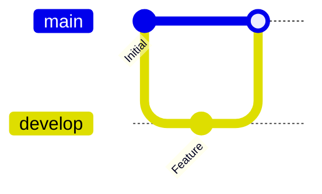

# Mermaid git graph: instructions for LLM agents

You are writing a Mermaid git graph. Emit the diagram source only.

Rules:

- The first line is `gitGraph`. The default branch is `main`.
- Commands: `commit`, `branch name`, `checkout name`, `merge name`, `cherry-pick id`.
- A commit message is `commit id: "Message"`. Quote the id when it contains spaces.
- Branch names match `[A-Za-z_][A-Za-z0-9_-]*` or are quoted: `branch "release-1"`.
- `checkout` the branch you are about to commit on. `merge` names an existing branch.
- Do not invent `gitGraph` keywords such as `pull` or `rebase`.
- Keep branch order consistent with the story the user described.
- Match the user's language in commit messages.
