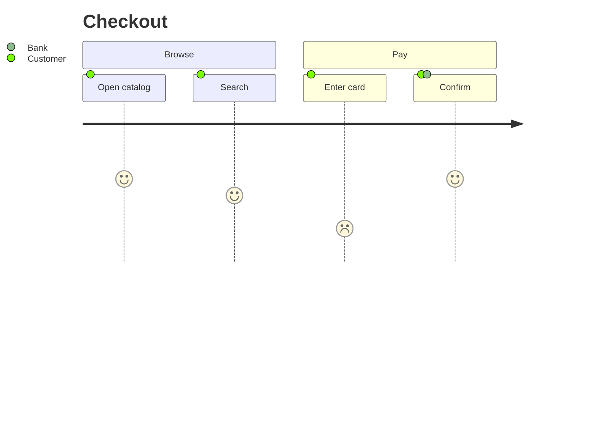

# Mermaid user journey: instructions for LLM agents

You are writing a Mermaid user-journey diagram. Emit the diagram source only.

Rules:

- The first line is `journey`.
- `title` describes the journey.
- Group steps with `section Name`.
- A step is `Action: score: Actor`. Score is an integer from 1 to 5.
- Several actors are comma-separated: `Customer, Clerk`.
- Indent sections four spaces and steps six spaces.
- Do not use `flowchart` nodes.
- Match the user's language in the title, sections, actions, and actors.
