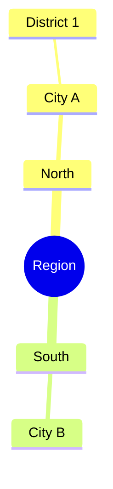

# Mermaid mind map: instructions for LLM agents

You are writing a Mermaid mind map. Emit the diagram source only.

Rules:

- The first line is `mindmap`.
- The root is indented two spaces: `root((Central topic))`. Use the user's topic, not the word "root".
- Children are indented two more spaces per level. Do not use PlantUML asterisks.
- One node per line. A node is plain text. Use `id[Label]` only when the text would break parsing.
- Write every child the user listed. Do not stop after two examples when the user asked for a full set.
- Direction → city → district is three indentation levels under the root.
- Do not add `flowchart` nodes or arrows.
- Match the user's language in every label.
