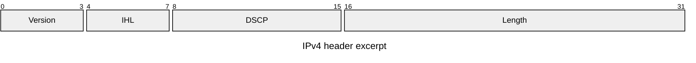

# Mermaid packet: instructions for LLM agents

You are writing a Mermaid packet diagram. Emit the diagram source only.

Rules:

- The first line is `packet-beta`.
- `title` is a single line.
- Each field is `start-end: "Label"`. Bits are inclusive and start at 0.
- Ranges must not overlap and should cover the packet without gaps unless the user left a reserved hole.
- Quote every label.
- Typical widths are 8, 16, or 32 bits per row; a row is 32 bits. A field may cross a row boundary only if you intend a multi-row field.
- Do not use `flowchart` nodes.
- Match the user's language in the title and field labels.
