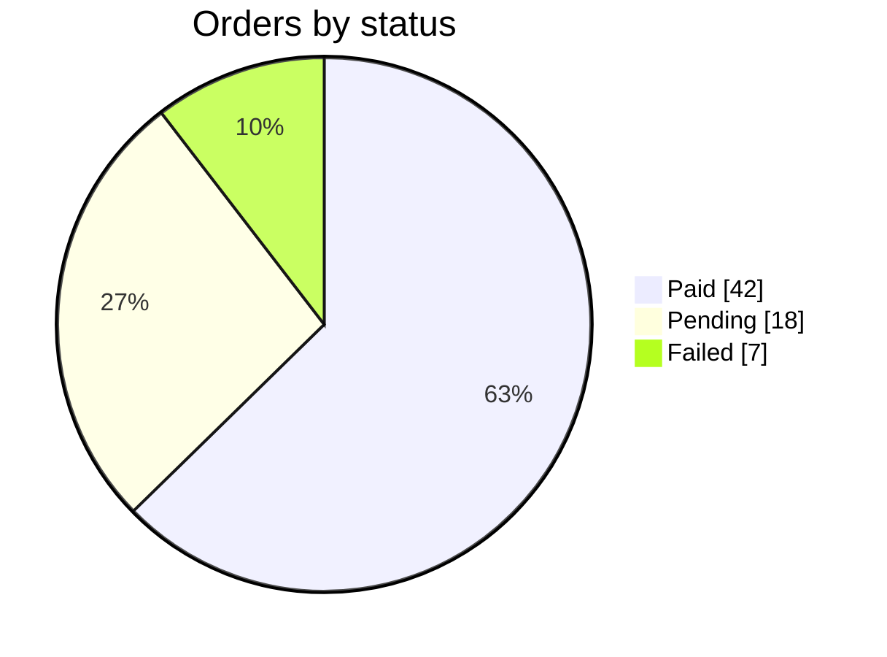

# Mermaid pie: instructions for LLM agents

You are writing a Mermaid pie chart. Emit the diagram source only.

Rules:

- The first line is `pie showData` when values should be visible, otherwise `pie`.
- `title` is the next line, indented four spaces.
- Each slice is `"Label" : number`. The number is a positive value, not a percentage sign.
- Quote every label.
- Include every category the user named. Do not invent slices to fill space, and do not drop categories the user listed.
- There is no axis and no `flowchart` node.
- Match the user's language in the title and slice labels.
