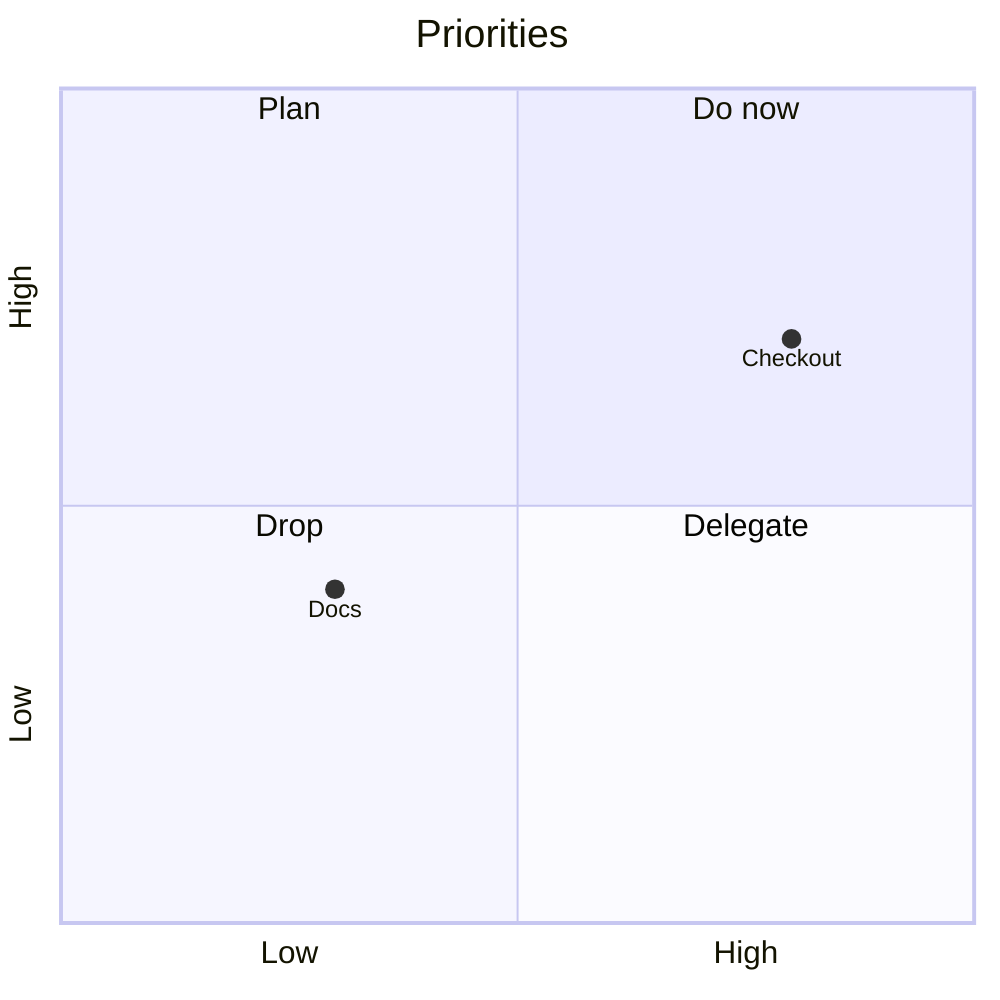

# Mermaid quadrant chart: instructions for LLM agents

You are writing a Mermaid quadrant chart. Emit the diagram source only.

Rules:

- The first line is `quadrantChart`.
- `title`, `x-axis Low --> High`, and `y-axis Low --> High` define the plane.
- `quadrant-1` is top-right, `quadrant-2` top-left, `quadrant-3` bottom-left, `quadrant-4` bottom-right.
- A point is `Label: [x, y]` with both coordinates between 0 and 1.
- Quote a label that contains a colon or comma: `"A: B": [0.2, 0.8]`.
- Include every item the user named. Do not add filler points.
- Match the user's language in the title, axis names, quadrant names, and point labels.
