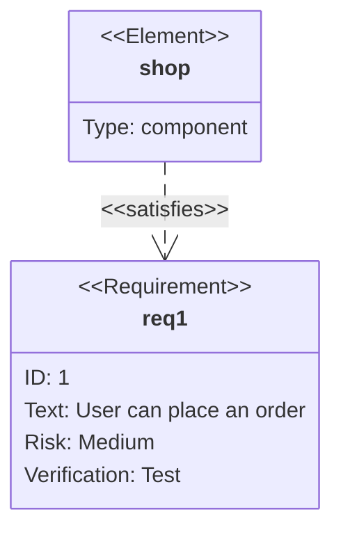

# Mermaid requirements: instructions for LLM agents

You are writing a Mermaid requirement diagram. Emit the diagram source only.

Rules:

- The first line is `requirementDiagram`.
- A requirement is `requirement id {` / `}` with `id`, `text`, `risk` (`low`, `medium`, `high`), and `verifymethod` (`analysis`, `test`, `demonstration`, `inspection`).
- Quote `text` when it contains spaces or non-ASCII characters.
- An element is `element id { type: component }`. `type` is a short ASCII word.
- Links: `elementId - satisfies -> reqId`. Other allowed verbs: `contains`, `copies`, `derives`, `refines`, `traces`, `verifies`.
- Requirement ids and element ids are ASCII (`req1`, `shop`).
- Match the user's language inside quoted `text`.
