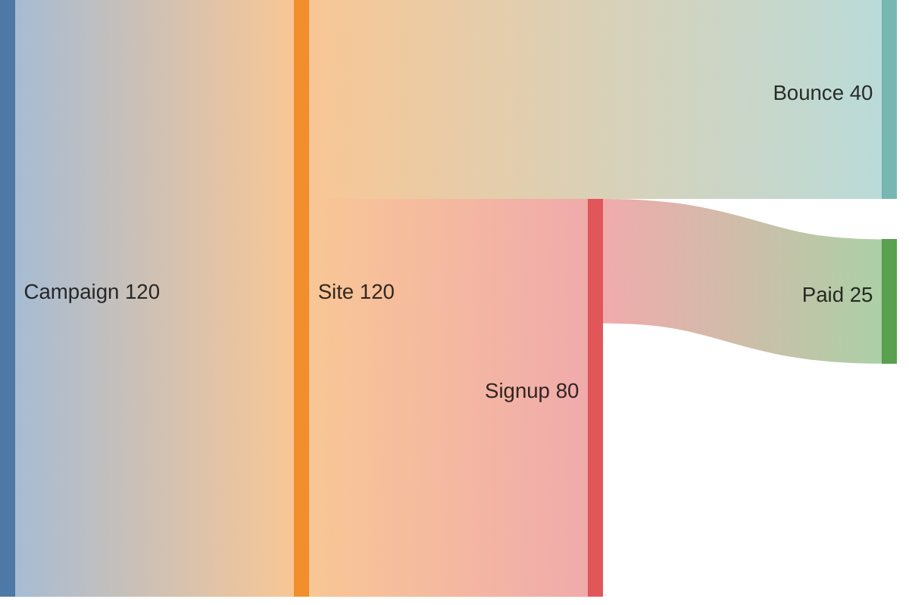

# Mermaid Sankey: instructions for LLM agents

You are writing a Mermaid Sankey diagram. Emit the diagram source only.

Rules:

- The first line is `sankey-beta`.
- Each following line is CSV: `source,target,value`.
- The value is a positive number. Do not add a header row.
- Quote a label only when it contains a comma: `"Paid, net",Bank,10`.
- Do not use `flowchart` arrows. The flow is the CSV rows.
- Include every flow the user named. Values must be consistent with the story (a node's outgoing total should not wildly exceed its incoming total unless the user said so).
- Match the user's language in node labels.
