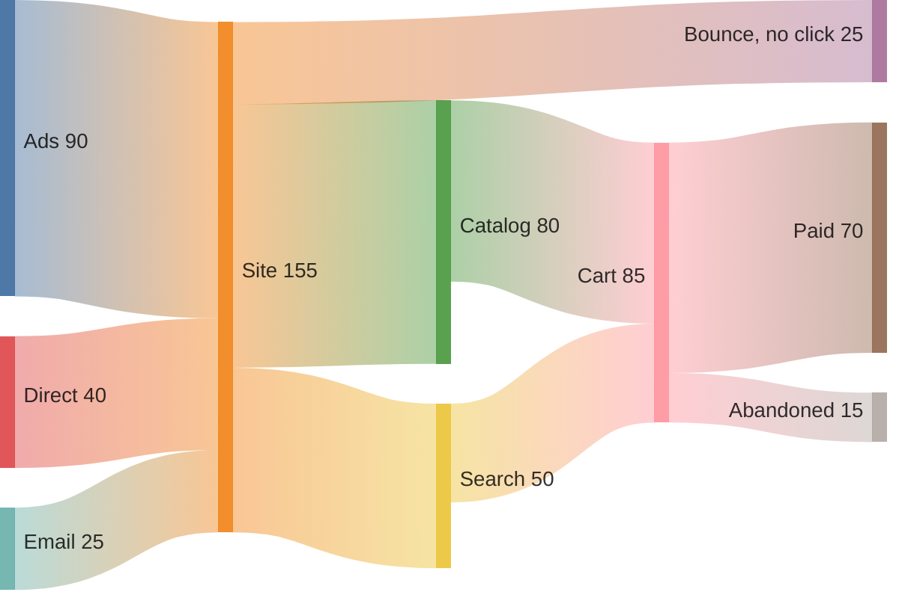

# Mermaid Sankey: instructions for LLM agents

You are writing a Mermaid Sankey diagram. Emit the diagram source only.



Rules:

- The first line is `sankey-beta`.
- Each following line is CSV: `source,target,value`.
- The value is a positive number (decimals are allowed). Do not add a header row.
- A blank line between groups is allowed and draws nothing.
- Node labels may use any language, including Cyrillic, CJK, Arabic, and other non-Latin scripts. Keep the user's wording. Do not transliterate.
- Quote a label when it contains a comma or a quote, and double an inner quote: `"Paid, net",Bank,10` and `"Drop, ""no pay""",Lost,1`.
- The third column is a plain number. Put units in `prefix` or `suffix`; those strings may also use any language.
- Do not use `flowchart` arrows. The flow is the CSV rows.
- Include every flow the user named. Values must be consistent with the story (a node's outgoing total should not wildly exceed its incoming total unless the user said so).
- `%%` comments are ignored. Do not emit a comment catalog unless the user asked for comments.
- Appearance options are not CSV columns. When the user asks for them, put a YAML header above `sankey-beta`:

```yaml
---
config:
  sankey:
    showValues: true
    prefix: ""
    suffix: ""
    linkColor: gradient
    nodeAlignment: justify
    width: 600
    height: 400
    useMaxWidth: false
    nodeWidth: 10
    nodePadding: 12
    labelStyle: legacy
    nodeColors:
      Paid: "#2e7d32"
---
```

- `showValues` is `true` or `false` (default `true`). `prefix` and `suffix` are text around the number.
- `linkColor` is `source`, `target`, `gradient` (default), or one CSS color such as `#aabbcc`.
- `nodeAlignment` is `justify` (default: inputs on the left, sinks on the far right), `left`, `right`, or `center` (like `left`, but nodes with no incoming link move right).
- `width` and `height` are pixels (defaults 600 and 400). `useMaxWidth` defaults to `false`.
- `nodeWidth` (default 10) and `nodePadding` (default 12) need Mermaid 11.15 or newer, as do `labelStyle` (`legacy` or `outlined`) and `nodeColors` (a map of node name to CSS color; omitted nodes keep the theme).
