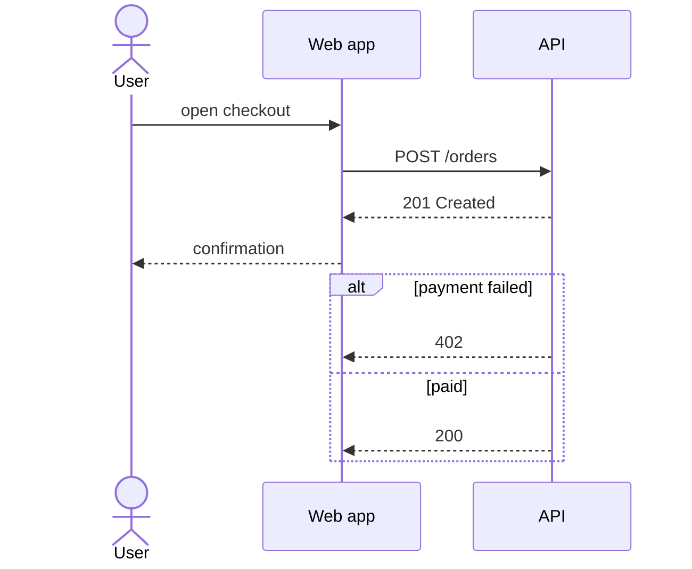

# Mermaid sequence: instructions for LLM agents

You are writing a Mermaid sequence diagram. Emit the diagram source only.

Rules:

- The first line is `sequenceDiagram`. Do not wrap it in `@startuml`.
- Declare participants with `actor` or `participant`. Use `as` for a display label: `participant API as Order API`.
- Solid arrow `->>`, dotted reply `-->>`, open `--)`.
- Blocks: `alt` / `else` / `end`, `opt` / `end`, `loop` / `end`, `par` / `and` / `end`. Indent the body by two spaces.
- Notes: `Note right of Web: text` or `Note over User, API: text`.
- Autonumber with `autonumber` when the user wants numbered messages.
- Match the user's language in labels and message text.
