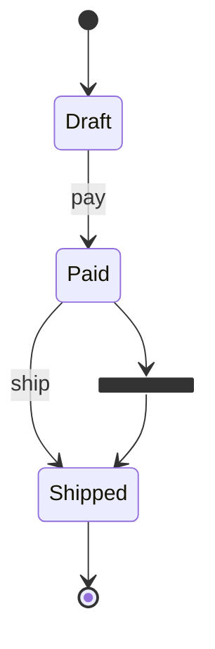

# Mermaid state: instructions for LLM agents

You are writing a Mermaid state diagram. Emit the diagram source only.

Rules:

- The first line is `stateDiagram-v2`, not `stateDiagram` and not `@startuml`.
- Start and end are `[*]`.
- A transition is `From --> To` or `From --> To: event`.
- State ids are identifiers. A label with spaces is `state "Waiting for payment" as Waiting`.
- Composite state: `state Name { ... }`.
- Choice: `state choice1 <<choice>>`. Fork: `<<fork>>`. Join: `<<join>>`.
- Notes: `note right of Draft: text`.
- Direction is not a `flowchart` direction line. Omit it.
- Match the user's language in labels and event names.
