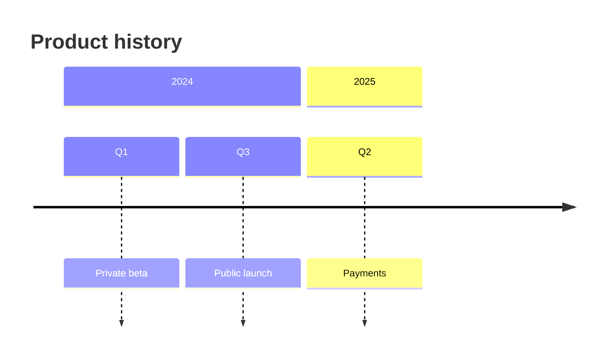

# Mermaid timeline: instructions for LLM agents

You are writing a Mermaid timeline. Emit the diagram source only.

Rules:

- The first line is `timeline`.
- `title` is one line.
- A `section` groups events. Under it, each event is `period : text`.
- Multiple events in one period: `period : first : second`.
- Indent sections four spaces and events four spaces.
- Do not use Gantt `dateFormat` or task ids.
- Include every event the user listed, in chronological order.
- Match the user's language in the title and event text.
