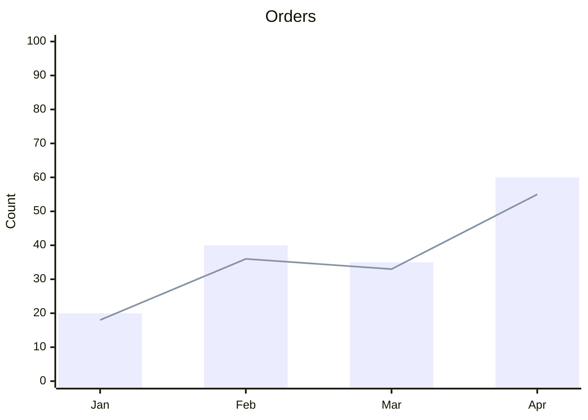

# Mermaid XY chart: instructions for LLM agents

You are writing a Mermaid XY chart. Emit the diagram source only.

Rules:

- The first line is `xychart-beta`.
- `title "Text"` is quoted when the title has spaces.
- `x-axis [a, b, c]` lists categories. The list length must equal every series length.
- `y-axis "Label" min --> max` sets the numeric range. `max` is above the largest value.
- A series is `bar [n, n, n]` or `line [n, n, n]`.
- Do not use `pie` slices or `flowchart` nodes.
- Match the user's language in the title and axis label. Category names may stay as the user wrote them (months, ids).
