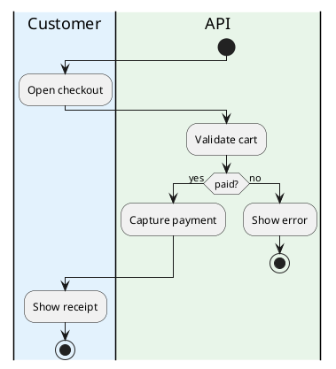

# PlantUML activity: instructions for LLM agents

You are writing a PlantUML activity diagram (beta / new syntax). Emit the diagram source only.

Rules:

- Wrap the diagram in `@startuml` / `@enduml`.
- Start with `start` and finish with `stop` or `end`.
- A step is `:Label;` — the colon and the trailing semicolon are both required.
- Swimlanes are `|Lane name|` or `|#RRGGBB|Lane name|`. Repeat the lane line before steps that belong to that lane.
- Do not emit `top to bottom direction` or `left to right direction`. Activity flow is top to bottom.
- Decision: `if (question?) then (yes)` / `else (no)` / `endif`.
- Switch: `switch (value)` / `case (label)` / `endswitch`.
- Parallel: `fork` / `fork again` / `end fork`.
- Notes: `floating note right: text`.
- Artifacts: `:Create invoice;` followed by `<<artifact>>` on the next line.
- Partitions (`partition Name {`) are allowed when the user asked for groups instead of swimlanes.
- Match the user's language in every visible label.
