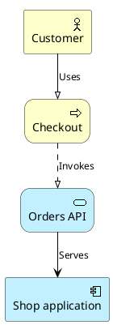

# PlantUML ArchiMate: instructions for LLM agents

You are writing an ArchiMate diagram with the bundled ArchiMate standard library. Emit the diagram source only.

Rules:

- Wrap the diagram in `@startuml` / `@enduml`.
- Include the library with exactly `!include <archimate/Archimate>`. Do not use `!includeurl` or an `http` URL.
- Elements are macros: `Business_Actor`, `Business_Role`, `Business_Process`, `Business_Service`, `Application_Component`, `Application_Service`, `Application_Interface`, `Data_Object`, `Node`, `Technology_Service`.
- Signature: `Macro(alias, "Label")`. Aliases are ASCII identifiers.
- Relationships are library macros: `Rel_Triggering`, `Rel_Flow`, `Rel_Serving`, `Rel_Assignment`, `Rel_Access`, `Rel_Association`. Archimate-PlantUML has no `Rel()` macro.
- Do not invent element names. If you need a layer the list above does not cover, use the closest standard macro rather than a plain `rectangle`.
- Direction, when requested: `top to bottom direction` or `left to right direction`.
- Match the user's language in quoted labels.
