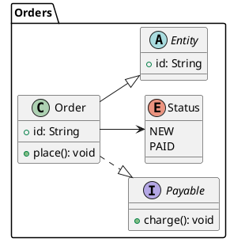

# PlantUML class: instructions for LLM agents

You are writing a PlantUML class diagram. Emit the diagram source only.

Rules:

- Wrap the diagram in `@startuml` / `@enduml`.
- A class body is `class Name {` then members then `}`. Visibility: `+` public, `-` private, `#` protected, `~` package.
- Static members are underlined with `{static}`. Abstract members use `{abstract}`.
- Relationships: `<|--` inheritance, `*--` composition, `o--` aggregation, `-->` association, `..>` dependency, `..|>` realization.
- Cardinality sits on the arrow: `Order "1" --> "*" Line`.
- `interface`, `enum`, `abstract class` are first-class keywords. Do not fake them with stereotypes unless you also need a stereotype.
- Packages: `package Name { ... }`. Namespaces: `namespace Name { ... }`.
- Notes: `note top of Order: text`.
- Direction, when requested: `top to bottom direction` or `left to right direction`.
- Optional layout pragma: `!pragma layout smetana`.
- Match the user's language in every visible label.
