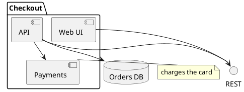

# PlantUML component: instructions for LLM agents

You are writing a PlantUML component diagram. Emit the diagram source only.

Rules:

- Wrap the diagram in `@startuml` / `@enduml`.
- A component is `[Name]` or `component "Name" as Alias`. Quote names that contain spaces.
- An interface is `() "Name" as Alias`. Connect it with `--` or `..`.
- Dependencies use `-->`. Do not use sequence-message arrows (`->` with a colon label) as the primary notation.
- Group components in `package`, `node`, `folder`, or `cloud` blocks.
- Databases: `database "Name" as Alias`. Queues: `queue "Name" as Alias`.
- Notes: `note right of [API]: text` or `note right of Alias: text`.
- Direction, when requested: `top to bottom direction` or `left to right direction`.
- Match the user's language in every visible label.
