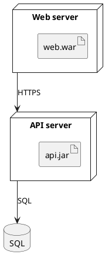

# PlantUML deployment: instructions for LLM agents

You are writing a PlantUML deployment diagram. Emit the diagram source only.

Rules:

- Wrap the diagram in `@startuml` / `@enduml`.
- Devices and hosts are `node "Label" as Alias { ... }`.
- Deployed binaries are `artifact "name.war"` inside the node.
- Data stores: `database "Label" as Alias`.
- Links between nodes: `alias --> alias : protocol`.
- Nested nodes are allowed: a node may contain another node.
- Notes: `note right of web: text`.
- Direction, when requested: `top to bottom direction` or `left to right direction`.
- Match the user's language in node labels. Keep artifact file names as given.
