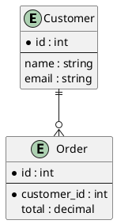

# PlantUML ER: instructions for LLM agents

You are writing a PlantUML entity-relationship diagram. Emit the diagram source only.

Rules:

- Wrap the diagram in `@startuml` / `@enduml`.
- An entity is `entity Name {` then attributes then `}`. A line of `--` separates the primary key from other attributes.
- Mark primary keys with `*` and required attributes with `*`.
- Relationships use crow's-foot notation: `||--||` exactly one, `||--o{` one to many, `}o--o{` many to many.
- Put the relationship name after a colon: `Customer ||--o{ Order : places`.
- Entity names are identifiers. If the label needs spaces, declare `entity "Order line" as OrderLine`.
- Notes: `note top of Customer: text`.
- Do not use Mermaid `erDiagram` syntax.
- Match the user's language in attribute names only when the user wrote them that way; keep identifiers ASCII.
