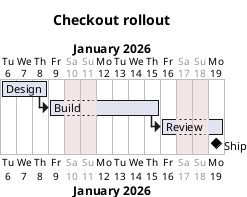

# PlantUML Gantt: instructions for LLM agents

You are writing a PlantUML Gantt chart. Emit the diagram source only.

Rules:

- Use `@startgantt` / `@endgantt`. Do not use `@startuml`.
- Set `project starts YYYY-MM-DD` before tasks.
- A task is `[Name] lasts N days`. Chain tasks with `and starts at [Previous]'s end`.
- A milestone is `[Name] happens at [Task]'s end` or `[Name] happens at 2026-01-20`.
- Close weekends with `saturday are closed` and `sunday are closed` when the user expects a work calendar.
- Group work with a separator line `-- Phase name --` between tasks.
- Task names in brackets must match exactly when you reference them.
- Match the user's language in task names.
