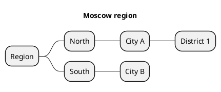

# PlantUML mind map: instructions for LLM agents

You are writing a PlantUML mind map. Emit the diagram source only.

Rules:

- Use `@startmindmap` / `@endmindmap`. Do not use `@startuml`.
- Depth is the number of leading asterisks: `*` root, `**` branch, `***` child, `****` grandchild. Add deeper levels when the user asked for them.
- One node per line. Do not put several nodes on one line.
- The root label is the user's central topic, not the word "Root".
- When the user lists every item in a group, write every item. Numeric minimums are floors, not caps.
- For direction → city → district trees: `**` direction, `***` city, `****` district.
- Optional layout: `top to bottom direction` or `left to right direction` on its own line after `@startmindmap`.
- Do not use Mermaid indentation or `root((...))`.
- Match the user's language in every node label.
