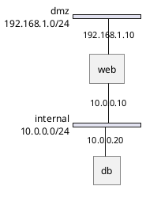

# PlantUML network (nwdiag): instructions for LLM agents

You are writing a PlantUML network diagram. Emit the diagram source only.

Rules:

- Use `@startnwdiag` / `@endnwdiag`. Do not use `@startuml`.
- The body is a single `nwdiag { ... }` block.
- Each LAN is `network name { address = "cidr"; ... }`.
- A host is `hostname [address = "ip"];`. The same hostname in two networks is one machine with two addresses.
- Do not draw `--` edges. nwdiag links hosts by placing them on the same network.
- Host names are identifiers. Do not quote them and do not use spaces.
- Match the user's language only in a `title` line if you add one. Keep host names ASCII.
