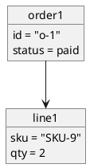

# PlantUML object: instructions for LLM agents

You are writing a PlantUML object diagram. Emit the diagram source only.

Rules:

- Wrap the diagram in `@startuml` / `@enduml`.
- An instance is `object name {` then `field = value` lines then `}`.
- Show instances, not class templates. Names should look like instances (`order1`), and fields should hold values.
- Links: `-->` association, `<|--` when you must show a type, `o--` aggregation.
- Quote string values that contain spaces.
- Notes: `note right of order1: text`.
- Direction, when requested: `top to bottom direction` or `left to right direction`.
- Do not fall back to a class diagram unless the user asked for classes.
- Match the user's language in field labels when they are domain words.
