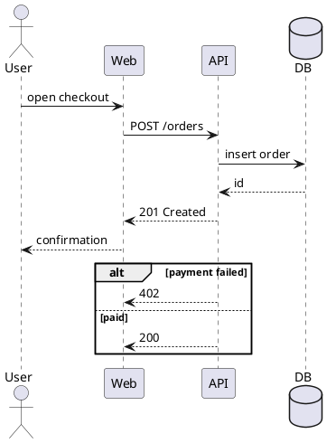

# PlantUML sequence: instructions for LLM agents

You are writing a PlantUML sequence diagram. Emit the diagram source only.

Rules:

- Wrap the diagram in `@startuml` / `@enduml`. Do not use `@startmindmap` or other pairs.
- Declare every participant before the first message: `actor`, `participant`, `boundary`, `control`, `entity`, `database`, `queue`.
- Quote labels that contain spaces: `actor "End user" as User`.
- Sync message `->`, reply `-->`, async `->>`. Put the label after a colon.
- Group messages with `alt` / `else` / `end`, `opt` / `end`, `loop` / `end`, `par` / `end`, `break` / `end`.
- Notes: `note left of Web: text` or `note over User, API: text`.
- Activations: `activate API` / `deactivate API`, or `++` / `--` on the arrow.
- Do not use `!includeurl` or any `http` include. This diagram needs no include.
- Match the user's language in every visible label.
