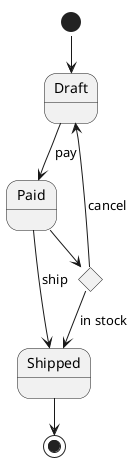

# PlantUML state: instructions for LLM agents

You are writing a PlantUML state diagram. Emit the diagram source only.

Rules:

- Wrap the diagram in `@startuml` / `@enduml`.
- Declare named states before transitions when the label has spaces or punctuation: `state "Label" as Alias`.
- The start and end pseudostates are `[*]`.
- A transition is `From --> To` or `From --> To : event`.
- Composite states: `state Name { ... }`.
- Choice: `state alias <<choice>>`. Fork / join: `<<fork>>` and `<<join>>`.
- History: `<<history>>` or `<<deepHistory>>`.
- Notes: `note right of Alias: text`.
- Direction, when requested: `top to bottom direction` or `left to right direction`.
- Do not use Mermaid `stateDiagram-v2` keywords.
- Match the user's language in every visible label. Keep aliases ASCII.
