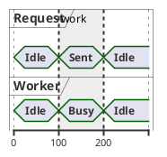

# PlantUML timing: instructions for LLM agents

You are writing a PlantUML timing diagram. Emit the diagram source only.

Rules:

- Wrap the diagram in `@startuml` / `@enduml`. Do not add `top to bottom direction`.
- Declare each signal before the timeline: `concise "Label" as Alias` or `robust "Label" as Alias`.
- `concise` is binary or short states. `robust` is for longer state names.
- Time markers are `@0`, `@100`, `@200` (integers). After each marker, set every signal that changes: `Alias is StateName`.
- Binary concise states are usually `Idle` and `Active`, or the states the user named.
- A constraint: `highlight 100 to 200 : label`.
- Notes: `note top of Alias: text` immediately after a time marker.
- Keep aliases ASCII. Match the user's language in quoted labels.
