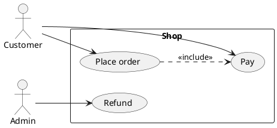

# PlantUML use case: instructions for LLM agents

You are writing a PlantUML use-case diagram. Emit the diagram source only.

Rules:

- Wrap the diagram in `@startuml` / `@enduml`.
- Actors: `actor "Label" as Alias` or `actor Alias`.
- Use cases: `usecase "Label" as Alias`. Put the system's use cases inside `rectangle "System" { ... }`.
- Associations from actors to use cases are `-->`.
- `<<include>>` and `<<extend>>` are dotted: `UC1 ..> UC2 : <<include>>`.
- Direction, when requested: `left to right direction` or `top to bottom direction`.
- Notes: `note right of UC1: text`.
- Match the user's language in actor and use-case labels.
