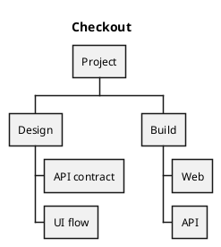

# PlantUML WBS: instructions for LLM agents

You are writing a PlantUML work-breakdown diagram. Emit the diagram source only.

Rules:

- Use `@startwbs` / `@endwbs`. Do not use `@startuml` or `@startmindmap`.
- Depth is leading asterisks: `*` root, `**` branch, `***` task, `****` subtask.
- One work item per line. The root is the project or goal the user named.
- Include every work item the user listed. Do not collapse children into the parent label.
- Optional direction: `left to right direction` or `top to bottom direction` after `@startwbs`.
- Match the user's language in every label.
